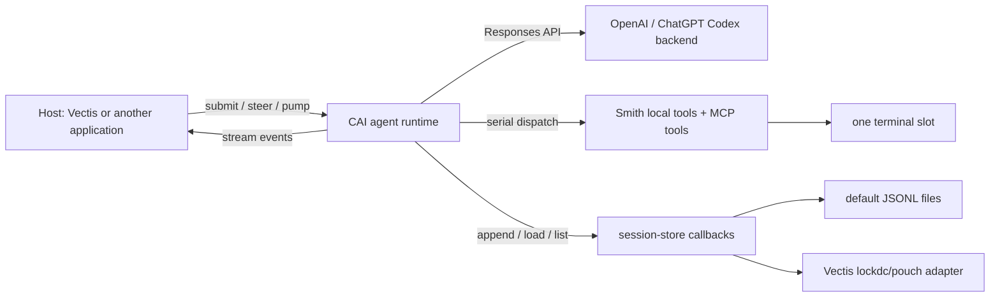
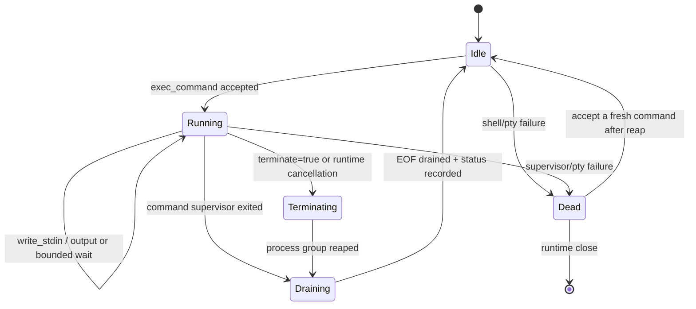

# CAI Agent Mode and the Smith Preset

**Status:** implementation specification with delivery-status notes

**Scope:** CAI agent-mode foundation and the first `smith` preset. This is a
design and delivery specification. Public headers define the current callable
surface; sections marked **Target** remain design intent. “MUST”,
“SHOULD”, and “MAY” are normative.

The first implementation is intentionally smaller than the full target design
in this document. The delivered surface is the owner-thread runtime, local or
callback-backed commits, steering, goals, Smith and Smith-review presets,
the local file/patch/image tools, one managed terminal slot, live-runtime
streaming handover export, and C/Lua reference renderers. Sections explicitly
labelled **Target** describe the next compatible increments; they are not claims
about the released ABI.

## 1. Product decision

CAI becomes the owner of an embeddable, client-side coding-agent loop. The
first preset is named **Smith**, exposed as `smith` and referred to in prose as
“Agent Smith” or simply “Smith”. Smith gives OpenAI coding models a Codex-like
prompt and tool contract while retaining CAI’s C89/POSIX embedding model.

The default visible identity is **Cai Smith**. An embedding product may replace
the identity, for example with **Vectis Agent Smith**, without forking the
prompt or agent runtime. A host may own its rendering, input widget, service
lifecycle, storage adapters, and product configuration, or embed `libcai_app`
for CAI's terminal UI and shared Pouch adapters. Core libcai owns
the model loop, tool contracts, terminal lifecycle, steering queue, session
semantics, compaction, and the default local session backend.

Smith is a preset, not the name of CAI’s generic agent runtime. Future presets
may select different prompts, tool exposure, policies, and model defaults over
the same runtime.

### 1.1 Host-defined presets

CAI exposes `cai_agent_preset` as the declarative profile for the shared agent
runtime. `cai_agent_preset_from_smith()` initializes the built-in Smith policy;
a host may copy it, give it a new stable name/prompt revision, replace either
developer prompt, alter defaults, and select its tool capabilities. A custom
ordinary prompt is a complete template and may contain the literal
`{{agent_identity}}`, which CAI substitutes without interpreting any other
template syntax. Repository instructions and the host extension remain ordered
after that prompt. When an ordinary template is omitted, CAI renders its
built-in prompt with an exact tool contract for the preset's selected
capabilities, so narrowing a Smith-derived preset cannot advertise disabled
tools. A custom reviewer prompt must retain the review JSON-report contract
when `supports_review` is enabled.

`cai_agent_runtime_config.preset_descriptor` snapshots the descriptor during
open, so C callers may use stack storage and the Lua facade may accept an
ordinary table safely. Smith remains the built-in `preset = "smith"`
convenience. The durable commit and Markdown handover record the selected
preset name and prompt revision. On resume, CAI rejects a commit that
names a different preset or prompt revision; legacy commits without this
metadata remain resumable and are upgraded at their next commit.

For example, a host can derive a Vectis profile without duplicating Smith's
tool policy:

```c
cai_agent_preset preset;
cai_agent_runtime_config config;

cai_agent_preset_from_smith(&preset);
preset.name = "vectis-engineer";
preset.prompt_version = "vectis-engineer-1";
preset.default_identity = "Vectis Engineer";
preset.developer_instructions =
    "You are {{agent_identity}}, the Vectis coding agent.";

cai_agent_runtime_config_init(&config);
config.workspace_directory = project_directory;
config.preset_descriptor = &preset; /* copied by cai_agent_runtime_open */
```

The Lua equivalent is `client:new_agent_runtime { preset = { ... } }`. Its
`preset` table uses the descriptor field names above and the
`cai.AGENT_PRESET_TOOL_*` capability constants. The binding only borrows that
table while calling into CAI; the opened runtime owns independent C copies.
Both surfaces accept `review_developer_instructions`,
`review_tool_capabilities`, and `supports_review` for a profile that may launch
an isolated reviewer.

For ordinary Lua runtimes, `mcp_clients = { client_a, client_b }` attaches
already-opened and initialized `cai.mcp_client` userdata at construction, and
`mcp_tool_config = { name_prefix = "...", strict = true }` supplies the shared
registration policy. The selected preset must include
`CAI_AGENT_PRESET_TOOL_MCP`; review runtimes reject MCP attachment. CAI retains
the Lua clients until the runtime closes, so an attached client cannot be
closed early and its discovered tools cannot outlive their transport.

This first delivery deliberately does **not** implement Codex-style
multi-agent/worktree coordination or a `wait_agent` tool. Remote capabilities
belong behind MCP or host-registered CAI tools. The only asynchronous execution
surface in Smith is its single managed terminal.

## 2. Evidence and upstream reference

The design is based on the Codex CLI checkout inspected on 2026-08-17 and on
the project-provided “CAI Agent And Vectis Integration” design note.

Important upstream observations:

- `codex-rs/core/src/tools/handlers/unified_exec/exec_command.rs` and
  `write_stdin.rs` define the model-visible `exec_command` and `write_stdin`
  contract. Codex assigns an execution identifier when the initial bounded
  read yields and requires that identifier for later terminal input/polls.
- `codex-rs/core/src/unified_exec/process.rs` and `process_manager.rs` protect
  each process with an interaction lock, separately track output closure and
  process exit, and only remove the process when its terminal result is final.
  Codex supports multiple process IDs. Smith must not copy that topology.
- `codex-rs/ext/goal/src/tool.rs`, `runtime.rs`, and `steering.rs` define
  `/goal`: persistent state, explicit create/get/update tools, accounting, and
  internal steering items. The visible tool semantics are useful; Codex’s
  thread database and continuation scheduler are not required by Smith.
- `codex-rs/core/src/session/turn.rs` compacts before sampling when context
  limits are reached and also when a model’s *compaction compatibility hash*
  changes. It does not compact merely because a model slug changes. A downshift
  to a smaller context window can also force compaction.
- `codex-rs/core/src/tasks/review.rs` runs review with a separate review
  rubric, no multi-agent collaboration, non-interactive permissions, and a
  model override when configured. `codex-rs/prompts/templates/review/rubric.md`
  is the current rubric source.
- The current checkout includes per-model instruction templates in
  `codex-rs/models-manager/models.json`. Codex can also receive model-owned
  instructions from its account/backend catalog, so a local snapshot does not
  prove equality with the current remote account's instructions.

Smith maintains pinned CAI prompt assets with explicit upstream provenance,
imports revisions deliberately, and tests the rendered request contract for
each supported profile. CAI identifies the exact snapshot it ships rather
than claiming equality with dynamically updated account instructions.

## 3. Goals and non-goals

### 3.1 Goals

1. Provide a host-neutral C API for driving an agent session one event at a
   time or through a blocking convenience wrapper.
2. Provide the `smith` preset with Codex-inspired instructions, stable
   tool names, serial tool dispatch, and defaults for
   `gpt-5.6-terra` at medium reasoning effort. Smith continues local tool
   rounds until the model stops, the host cancels, or execution policy denies
   an operation; it does not impose an arbitrary round ceiling. Dispatch still
   preserves one-call-at-a-time terminal ownership.
3. Let an application stream model deltas to any renderer without CAI knowing
   about libmdf, a TUI, or a UI toolkit.
4. Queue user steering safely while a model response or tool loop is active,
   then inject it at the next safe model-request boundary after the next tool
   completion.
5. Supply a **single** durable terminal slot. It must never report a command
   complete until its process supervisor has observed completion, and it must
   never run a second command concurrently.
6. Persist portable, local-first session state with callback replacement for
   lockdc/pouch, remote stores, or another application database.
7. Keep session history client-side and compact it client-side. A resumed
   session must not depend on a server-side previous response ID.

### 3.2 Non-goals for the first Smith delivery

- A CAI TUI, Markdown renderer, line editor, or dependency on libmdf/softline.
- Codex Desktop plugins, worktrees, collaboration agents,
  or `wait_agent`.
- Recreating Codex’s sandbox/approval service. Smith exposes policy callbacks;
  the embedding application supplies enforcement.
- A generic shell daemon that promises to retain arbitrary interactive shell
  state across process crash or session resume.
- Background tasks that outlive the single terminal supervisor. Programs that
  deliberately daemonize or escape their process group are outside terminal
  tracking and MUST be reported as such rather than claimed as tracked jobs.

## 4. Architecture



The runtime has exactly one owner thread. CAI may perform blocking model I/O
and tool orchestration on an internal worker, but it never invokes a host UI,
libmdf, softline, Lua, or renderer callback there. When an event receiver is
configured, CAI queues immutable runtime events and the owner receives them
only through `pump`. A pollable wakeup descriptor becomes readable whenever
such an event is queued, allowing a host to integrate CAI directly into a
softline/libmdf event loop without timer polling. With no event receiver, CAI
is poll-only: it queues no runtime events and the host observes only runtime
state, so an undrained event queue cannot stall the worker.

An event-driven host can opt into `synchronize_input_boundaries` to collect
owner-thread input before the next request. The worker emits `INPUT_BOUNDARY`
after a response/tool round and waits for its callback to return. Foreground
children inherit this setting and forward their boundaries to the owner. Close
and turn cancellation interrupt the wait; callback failure ends that operation.
This option requires an event callback and a host that keeps pumping. It is off
by default for autonomous SDK consumers. `libcai_app` enables it interactively
so pending steering remains in Softline's editable queue until a safe seam.

CAI MAY use an internal reader thread only for a blocking POSIX terminal or
network transport. Such a thread may append bytes to CAI-owned bounded buffers
and signal a wakeup fd; it MUST NOT call an application callback. The portable
baseline uses host-driven nonblocking/pollable I/O where available.

The runtime serializes all model requests and all tool invocations. Smith sets
`disable_parallel_tool_calls = 1`; receiving multiple function calls in one
model response is a protocol error unless a future preset explicitly provides
a deterministic serialisation policy.

### 4.3 Runtime observability

`cai_agent_runtime_config.logger` accepts an optional borrowed
`pslog_logger *`. When it is NULL, the runtime inherits its client logger;
`logger_disabled` suppresses either source. CAI never owns either logger.
Runtime logs are structured lifecycle diagnostics—open, accepted input kind,
tool lifecycle, and subagent lifecycle—and contain no user prompts, tool
arguments, delegated instruction text, or streamed model output. This lets a
host retain its own privacy and presentation policy while still observing
runtime health.

The complete final child instruction is exposed separately as
`subagent_instruction` on `SUBAGENT_STARTED`. It is borrowed until the event
callback returns and is never abbreviated. The existing event `data` remains
the concise launch display summary. Hosts normally render only that summary;
they can inspect or reveal the full instruction for audit, diagnostics, or an
explicit advanced UI mode without reconstructing it from tool arguments.

## 5. Public API shape

Existing `cai_agent`, `cai_session`, `cai_stream_sinks`, local tool registry,
MCP client, history export/import, and `cai_session_compact`
remain supported. Smith is additive. New public declarations belong in
`include/cai/agent_runtime.h`; common opaque declarations may be re-exported
from `include/cai/cai.h` only when that reduces include friction.

The delivered API is declared in `include/cai/agent_runtime.h`. It includes
the one-slot terminal configuration and lifecycle facts, semantic local-tool
outcomes, and the `smith` and `smith-review` presets. Exact field ordering is
ABI and must evolve only through CAI’s normal ABI-version process; this section
summarises the contract rather than duplicating the header verbatim.

```c
typedef struct cai_agent_runtime cai_agent_runtime;
typedef struct cai_agent_session_store cai_agent_session_store;

typedef enum cai_agent_run_state {
  CAI_AGENT_IDLE,
  CAI_AGENT_SAMPLING,
  CAI_AGENT_DISPATCHING_TOOL,
  CAI_AGENT_COMPLETED,
  CAI_AGENT_FAILED,
  CAI_AGENT_CANCELLED
} cai_agent_run_state;

typedef struct cai_agent_runtime_config {
  const char *preset;              /* NULL/"smith"/"smith-review" */
  const char *workspace_directory; /* required canonical workspace root */
  const char *agent_identity;      /* default: "Cai Smith" */
  const char *model;               /* Smith default: gpt-5.6-terra */
  const char *reasoning_effort;    /* Smith default: medium */
  const char *reasoning_summary;   /* Smith default: auto */
  const char *review_model;        /* review child inherits model when NULL */
  const char *review_reasoning_effort; /* review child inherits effort when NULL */
  const char *review_reasoning_summary; /* review child inherits mode when NULL */
  const char *developer_instructions_extension;
  cai_mcp_client *const *mcp_clients;
  size_t mcp_client_count;
  const cai_mcp_tool_registration_config *mcp_tool_config;
  int enable_image_generation;
  const cai_agent_session_store *session_store; /* NULL selects local JSONL */
  const char *session_scope;       /* NULL selects canonical workspace path */
  const char *session_id;          /* NULL generates a new identifier */
  int resume_latest;               /* nonzero: select latest matching session */
  int disable_default_session_store;
  size_t event_queue_limit;
  size_t steering_queue_limit;
  cai_agent_runtime_event_fn event_callback;
  void *event_context;
  size_t turn_queue_limit;
  cai_agent_runtime_event_fn review_event_callback;
  void *review_event_context;
} cai_agent_runtime_config;

void cai_agent_runtime_config_init(cai_agent_runtime_config *config);
int cai_agent_runtime_open(cai_client *client,
                           const cai_agent_runtime_config *config,
                           cai_agent_runtime **out, cai_error *error);
int cai_agent_runtime_set_model(cai_agent_runtime *runtime, const char *model,
                                cai_error *error);
const char *cai_agent_runtime_model(cai_agent_runtime *runtime);
int cai_agent_runtime_get_settings(cai_agent_runtime *runtime,
                                   cai_agent_runtime_settings *effective,
                                   cai_agent_runtime_settings *pending,
                                   cai_error *error);
int cai_agent_runtime_update_settings(
    cai_agent_runtime *runtime, const cai_agent_runtime_settings *requested,
    cai_agent_runtime_control_result *result, cai_error *error);
int cai_agent_runtime_cancel_turn(cai_agent_runtime *runtime,
                                  cai_error *error);
int cai_agent_runtime_submit(cai_agent_runtime *runtime, const char *text,
                             cai_error *error);
int cai_agent_runtime_submit_interactive(cai_agent_runtime *runtime,
                                         const char *text, cai_error *error);
int cai_agent_runtime_start_review(cai_agent_runtime *parent,
                                   const cai_agent_review_request *request,
                                   cai_agent_runtime **out_review,
                                   cai_error *error);
int cai_agent_runtime_finish_review(cai_agent_runtime *parent,
                                    cai_agent_runtime *review,
                                    cai_error *error);
int cai_agent_runtime_submit_steering(cai_agent_runtime *runtime,
                                      const char *text, cai_error *error);
int cai_agent_runtime_submit_queued(cai_agent_runtime *runtime,
                                    const char *text, cai_error *error);
int cai_agent_runtime_pump(cai_agent_runtime *runtime, long timeout_ms,
                           cai_error *error);
int cai_agent_runtime_wakeup_fd(const cai_agent_runtime *runtime,
                                int *out_fd, cai_error *error);
int cai_agent_runtime_state(cai_agent_runtime *runtime,
                            cai_agent_run_state *out, cai_error *error);
int cai_agent_runtime_export_markdown(cai_agent_runtime *runtime,
                                      cai_sink *sink, cai_error *error);
int cai_agent_runtime_export_markdown_file(cai_agent_runtime *runtime,
                                           const char *app_name,
                                           const char *path, char *out_path,
                                           size_t out_path_capacity,
                                           cai_error *error);
void cai_agent_runtime_close(cai_agent_runtime *runtime);
```

`submit` is permitted only in `IDLE`, `COMPLETED`, or a terminal error state
after that state has been observed, and only when no queued normal turn is
already waiting. `submit_interactive` is the normal Codex-compatible receiver:
it atomically starts from one of those stable states or steers an active normal
turn. It rejects isolated review and inline compaction, which Codex likewise
does not steer. `submit_steering` is permitted during an active sampling or
tool-dispatch state and is bounded, durable, FIFO, and
non-blocking with respect to network/model progress. `submit_queued` is the
separate normal-turn receiver: it queues a durable FIFO user turn that begins
only after the active turn becomes terminal (or begins immediately from an
idle runtime). Both receivers have `_threadsafe` variants. They copy only the
input under a short mutex, append durable journal events, signal the wakeup
descriptor, and never call the host event callback.

`set_model` is owner-thread-only and requires the same stable boundary as
conversation export: no active or queued turn, steering, goal control, or
review/subagent pause. It updates the active parent model that future turns and
inherited subagent defaults use. For ChatGPT auth, CAI obtains model metadata
from Codex's `/models` endpoint and uses its opaque compatibility hashes:
different declared hashes compact non-empty local history, while equal or
missing hashes retain it. The successful selection is committed with the
compacted history, if any.

`update_settings` accepts model, reasoning effort, reasoning-summary mode, and
service tier
together. Applied selections are committed atomically; a commit failure
restores the previous effective settings. During an active turn, changes merge
into pending settings and apply at the next durable tool-round or turn boundary.
Pending settings are discarded on close. Durable state records the active
request model separately from the history model used for compatibility checks.
Resume restores saved request settings when corresponding config fields are
NULL; explicit fields override each saved setting independently. The CLI maps
`/model [MODEL [EFFORT]]` and `/reasoning [EFFORT]` onto this receiver.

`export_markdown` is the live-runtime-only handover projection receiver. It
writes incrementally to the caller's `cai_sink`; it neither reopens a session
from a store nor materializes the complete history or Markdown as an
intermediate buffer. It is owner-thread-only and requires a stable runtime
boundary with no model/tool operation or queued host input. During export CAI
holds the runtime lock while it writes to the sink, therefore a sink callback
must not call back into that runtime. `export_markdown_file` is the small local
convenience layer: it creates a file mode `0600` with `O_EXCL`, never replaces
an existing file, and streams to it. With no explicit path, it creates
`<workspace>/<app_name>-session-<xid>.md`; the default rejects a session ID
that cannot safely form that filename. Callers can pass an explicit path
or use the sink receiver for clipboard, file-picker, or remote destinations.

`pump` advances one or more currently-ready operations until the timeout or a
state boundary. It returns `CAI_OK` for “no event before timeout”; callers
inspect state and events. The convenience `run`/`stream_auto` wrappers are
implemented as a pump loop and retain their present synchronous behavior.

### 5.1 Events

Events are explicit objects delivered through a registration callback and a
bounded queue. The delivered set includes `RUN_STARTED`, `RUN_STATE_CHANGED`,
`RUN_COMPLETED`, `RUN_FAILED`, `TEXT_DELTA`, `TOOL_CALL_STARTED`,
`TOOL_CALL_COMPLETED`, `TOOL_CALL_FAILED`, `STEERING_QUEUED`, `TURN_QUEUED`,
`STEERING_DELIVERED`, `SESSION_COMMITTED`, and the terminal lifecycle
events `TERMINAL_COMMAND_STARTED`, `TERMINAL_OUTPUT`, `TERMINAL_WAITING`,
`TERMINAL_COMMAND_COMPLETED`, and `TERMINAL_COMMAND_CANCELLED`. Each carries
a monotonic sequence and state snapshot; text data is bytes plus an explicit
length, not a NUL-terminated string. Final terminal events carry the observed
exit/signal status, duration, total observed bytes, output truncation, and the
truthful `detached_processes_possible` flag.

`REASONING_SUMMARY` carries only the provider-issued reasoning-summary stream,
not raw hidden chain-of-thought and not a CAI-generated substitute. Smith and
Smith-review request the provider-directed `auto` summary mode by default. A
generic runtime renderer decides whether and how to display that event; CAI
never silently substitutes it into normal answer text.

The application feed separates answer, reasoning-summary and tool blocks by a
blank row. A summary heading stays in the status line. Its body is streamed as
a Markdown blockquote into libmdf, which owns quote markers, styling and line
wrapping. CAI adds no markers to the rendered reasoning rows. Answer and summary
blocks may alternate within one response without ending the turn or restarting
the output stream. Quote colors and body styling follow libmdf's active theme;
the default theme retains normal body text.

Interactive `/quit` and `/exit` replace the gray message line with `Goodbye.`
before the editor releases the terminal. The farewell stays in that status
line, with no farewell added to the conversation feed.

`RESPONSE_COMPLETED` marks the end of every successfully streamed and
persisted model response, including responses that request local tools before
the automatic continuation. It is distinct from `RUN_COMPLETED`: a run can
continue when a tool result or steering input produces another response. Hosts
close the active text or reasoning presentation on this event so each following
response begins with its own visible label.

An independently opened reviewer emits `REVIEW_REPORT`, containing its
schema-validated JSON, for hosts that explicitly want the structured report.
`REVIEW_HANDED_OFF` carries a human-readable Markdown rendering after that
report enters parent history. When a reviewer runs through `run_review`, CAI
does not forward the child raw JSON text or `REVIEW_REPORT` event into the
parent event stream: the parent receives the Markdown handoff instead. This
keeps structured data available to the tool caller without making raw JSON the
operator's visible result.

CAI retains event storage only until the callback returns or the consumer
releases the event. A host feeding libmdf copies text or reasoning-summary
bytes in its callback and does rendering on its own chosen thread.

### 5.2 Generic agent-mode presentation boundary

This is CAI agent-mode infrastructure, not Smith-specific UI behavior. Every
agent-mode preset uses the same event and presentation contract; Smith is the
first preset to require the terminal extensions below. Presets select prompt,
tools, and policy, while hosts own all rendering.

Agent-mode events are a UI-ready *fact* stream, never a CAI UI policy. The
runtime does not emit ANSI sequences, choose colors, abbreviate commands,
impose a line-display limit, or print a synthetic transcript. A TUI, GUI, log
adapter, or test recorder consumes the same events and makes those choices
locally. This keeps terminal/safety correctness independent from a particular
renderer while making a good renderer straightforward to write.

The generic terminal-manager contract provides `TERMINAL_COMMAND_STARTED`,
`TERMINAL_OUTPUT`, `TERMINAL_WAITING`, `TERMINAL_COMMAND_COMPLETED`, and
`TERMINAL_COMMAND_CANCELLED`. A non-zero exit is a completed command with its
observed status, not a synthetic terminal failure event. Every terminal
event carries the stable runtime terminal ID, command ID, originating tool-call
ID, state transition, and monotonic sequence. Start events carry the submitted
command and resolved working directory; output events carry exact byte spans
and an explicit length; final events carry exit/termination status, duration,
and total captured/omitted byte counts. `TERMINAL_WAITING` is emitted at most
once for one model `write_stdin`/poll operation when that operation produces no
new terminal output. It is not a periodic heartbeat.

Generic tool lifecycle events carry stable tool-call IDs, tool names, a stable
`CAI_AGENT_TOOL_ACTION_*` classification, an optional best-effort primary
target, and a confirmed target count for completed patches. CAI derives these
facts from validated local-tool arguments and the native `apply_patch` result;
hosts do not need to parse model-visible output to render `Read <path>` or
`Patched <path>`. Arbitrary tool/MCP output remains opaque bytes and is
classified as `EXTERNAL` unless a future tool contract provides richer facts.

Successful native patches also emit `TOOL_PATCH_LOCATIONS` before `TOOL_PATCH`.
The locations stream contains ASCII `old new\n` rows in submitted update-hunk
order, followed by an empty chunk; positions are one-based original/result file
lines captured at preflight matches. Add-file numbering starts at one. The
subsequent patch stream preserves the exact submitted bytes. Rejected patches
emit neither stream. Renderers need no filesystem or VCS reads for this gutter.

The C and Lua `smith-terminal` examples are compact reference presentations
over this generic contract: render `$ <command>` on start, dim only the first
ten physical output lines across the command's full lifetime, emit one omission
summary when appropriate, show a waiting line only under the rule above, and
report an abbreviated completed command with exit status and duration. Their
display cap affects presentation only: CAI still drains the PTY and preserves
its separate bounded model-visible terminal result. The examples also render
provider-issued `REASONING_SUMMARY` deltas as visibly labelled progress, normal
model text as a visibly labelled Smith response, semantic local-tool receipts
such as `Read <path>` and `Patched <path>`, and a formatted inline reviewer
report. Review output is never hidden merely because it has also been placed
in the parent model context.
Snapshot tests cover these examples' rendering policy; core runtime tests cover
the underlying facts.

## 6. Smith preset and prompt assets

Smith must expose a named preset descriptor, not force callers to assemble a
fragile group of flags. Its initial defaults are:

| Setting | Smith default |
| --- | --- |
| Model | `gpt-5.6-terra` |
| Reasoning effort | `medium` |
| Reasoning summary | provider-directed `auto` stream |
| Continuity | client history |
| Local history | required |
| Parallel tool calls | disabled |
| Workspace scope | canonical absolute start directory |
| Terminal | enabled: one policy-gated managed command at a time |
| Goals | enabled |
| MCP | enabled when configured |
| Image generation | enabled only when backend/capability exists |

The live test profile overrides model to `gpt-5.6-luna`, uses low reasoning
effort for coding, and uses medium reasoning effort for isolated review. It
must exercise the same tool schemas and prompt asset as Smith; a separate
testing prompt is prohibited.

### 6.1 Prompt ownership and rendering

CAI stores prompt sources under `prompts/smith/`. Each source is the exact
`model_messages.instructions_template` from the pinned Codex model catalogue.
`prompts/smith/manifest.json` records each profile's revision, source selector,
source/template SHA-256 and matching model identifiers, the renderer policy,
fallback profile, and separately pinned review-rubric provenance.

| Model identifiers | Bundled base |
| --- | --- |
| `gpt-5.6-sol`, `gpt-5.6-terra`, `gpt-5.6-luna`, `codex-auto-review` | Shared GPT-5.6 template |
| `gpt-6-luna` | GPT-6 Luna template |
| `gpt-6-sol` | GPT-6 Sol template |
| `gpt-6.1-sol` | GPT-6.1 Sol template |
| `gpt-6-astra` | GPT-6 Astra template |

The optional `openai/` provider prefix selects the same base. Selection uses
exact model identifiers; an unknown model uses the GPT-5.6 fallback rather
than guessing a future model's contract. Custom preset templates and isolated
review rubrics are independent of this catalog.

The GPT-6 profiles change communication, permission handling and autonomy,
and have distinct working/testing guidance. CAI preserves those model-owned
instructions. Their references to `functions.exec`, Promise-based batching,
asynchronous questions, app discovery and orchestrator skill APIs describe
Codex facilities. CAI's overlay maps these to serial registered tools, ordinary
assistant questions which wait for a user reply, and `read_skill` for its
configured catalog. No connector or tool is advertised merely because its
name appears in an upstream prompt. Goal token budgets require an explicit
numeric user request; durable goals retain CAI's existing lifecycle.

In this snapshot, GPT-6 Luna says to add/run tests only when the user asks for
testing or verification. GPT-6 Sol permits meaningful focused verification and
limits repeat testing; GPT-6.1 Sol and Astra carry similar focused-verification
guidance with revised permission and communication wording. User instructions
and the host's applicable AGENTS.md policies take precedence. These differences
are preserved rather than flattened into a shared GPT-6 prompt.

Imported `*-codex.md` files are deliberately byte-for-byte upstream source
material. The build rejects changed source or template hashes. Templates
change only the identity phrases `You are Codex` and `As Codex` to
`{{agent_identity}}`, then appends the `{{agent_tools}}` CAI overlay.
That overlay is later developer instruction and MUST state only an actual CAI
capability or host-interface difference:

| Upstream behavior | CAI replacement |
| --- | --- |
| `commentary` and `final` channels | Ordinary assistant output and host-rendered events; a concise visible preamble before tool work and a self-contained final response. |
| Parallel tool calls | One serial tool dispatch; one managed terminal slot. |
| Codex tool namespace and approvals | Only registered CAI/MCP tool schemas and host policy callbacks. |
| A named upstream tool is absent from the selected CAI capability set | The renderer removes only the exact upstream sentence that names it, so a disabled `apply_patch` or terminal is never advertised. |
| Codex skill discovery/providers | Only the configured global CAI skills catalog and `read_skill`. |
| `update_plan` | Not available. Goals remain durable state and are not presented as a plan substitute. |
| Codex AGENTS discovery | CAI global policy first, then optional Codex global policy and repository traversal; default repository lookup reads only the exact workspace file. |

No other upstream behavior may be weakened, removed, or restated in the CAI
overlay or capability redaction. New divergence requires a documented
capability reason, prompt snapshot coverage, and representative live evaluation
before it is accepted.

The manifest's `profiles` array owns selection and provenance; CMake generates
the private C catalog and byte assets from it. Ordinary builds never read a
Codex checkout. `scripts/import_smith_prompts.sh CODEX_CHECKOUT` is an explicit
source-data generator which requires a committed upstream catalog.

Prompt sources are imported as Apache-2.0-compatible source material with
their provenance and license recorded. CAI keeps prompt assets
separate from host configuration and never downloads or mutates them at
runtime. Updating an upstream instruction requires a new reviewed manifest,
hashes, rendered-request tests, and a compatibility decision for existing
sessions.

Changing model replaces only the captured model-owned prefix at the existing
safe runtime boundary. The capability overlay, repository policy, skill catalog,
subagent guidance and host extension remain captured in the session's agent;
switching models does not reread files or create new tool processes. Commit
failure rolls back the model, reasoning settings and prompt together. Resume
restores the model selection and chooses its bundled base before inference.
The public C API, shared-library ABI and independently versioned session format
are unchanged; model-profile provenance is supplied by the manifest hashes.

The renderer has exactly two automatic content substitutions in imported base
instructions: the `You are Codex` and `As Codex` identity phrases become
`{{agent_identity}}`, defaulting to `Cai Smith`. It MUST NOT blanket-replace
the word “Codex”: product names, tool names, provenance text, or user-supplied
instructions are not identity substitutions. A downstream product changes the
identity through config; it does not edit the prompt asset.

The Smith renderer produces, in order:

1. Smith base/model instructions with identity substitution;
2. selected preset policy fragments (terminal, tools, goal, storage);
3. an optional global `AGENTS.md` policy. The global default is
   `${XDG_CONFIG_HOME:-$HOME/.config}/cai/AGENTS.md`; a host may instead set
   an explicit agent configuration directory, exact file path, or a
   callback-backed global instruction store. CAI does not traverse workspace
   ancestors by default and next reads the exact workspace file.
   `codex_compat_agents_md` first appends `${CODEX_HOME}/AGENTS.md` (or
   `$HOME/.codex/AGENTS.md` when CODEX_HOME is unset/empty), then reads repository
   files from the nearest `.git` ancestor through `workspace_directory`;
4. the optional global skills catalog, when the selected preset enables
   `CAI_AGENT_PRESET_TOOL_SKILLS` and discovery finds valid packages;
5. host-supplied developer extension fragment, if configured;
6. the user input or internal context fragment.

Commits record the preset name and prompt revision. Resume validates them
against the selected runtime preset; mismatches fail rather than migrating
prompt assets automatically. Build-time prompt hashes belong to the bundled
asset manifest, not to a runtime prompt-migration API. Resume reconstructs the
current developer instructions, including files read at startup, around the
restored request model. Model switches and compaction retain those instructions
without rereading files; restart to read file changes.

Global policy is loaded from an ordinary file or host-supplied byte source;
saved conversation state does not override its startup selection. Rendered
instructions can appear in saved context and Markdown exports; this does not
make configuration Pouch-backed. CAI's `cai_blob_store` is the
common C-only callback contract for named byte objects. Its `load` callback is
sufficient for `AGENTS.md`; ChatGPT auth requires both `load` and atomic
`replace`, using the default key `auth.json` or a host-selected opaque key.
The file-backed auth default remains `$XDG_STATE_HOME/cai/auth.json` (or
`$HOME/.local/state/cai/auth.json`). Lua accepts only native blob-store
userdata backed by C callbacks, so these callbacks never enter Lua state from
an auth refresh or runtime worker.

### 6.1.1 Global skills

Skills are catalog-first instruction packages, not workspace files. CAI only
discovers them under one configured global root: `skills_directory`, then
`<agent_config_directory>/skills`, then
`${XDG_CONFIG_HOME:-$HOME/.config}/cai/skills`. It never probes `.agents`, a
workspace, or ancestors. A host may replace filesystem discovery with the
C-only `cai_skill_provider` callback pair; the provider is copied by value and
must never re-enter a language runtime from an agent worker.

Each package is a directory with a private regular `SKILL.md`. CAI reads its
bounded YAML front matter at construction, requires `description`, and
adds `name: description` to the developer catalog. The catalog tells the model
to select a skill when the user names it **or** the task clearly matches its
description, then call `read_skill` to obtain the complete `SKILL.md`. This is
the same natural-language activation model as Codex; `$name` syntax is neither
required nor parsed by CAI. `read_skill` also reads package-relative supporting
resources, rejects absolute paths, traversal, symlinks, and non-private files,
and is bounded to 1 MiB per resource.

`/skills` renders the active runtime's catalog as a Markdown table of skill
names and descriptions. `cai_agent_runtime_visit_skills` exposes this immutable
catalog on the owner thread, including during a turn, without provider calls
or filesystem discovery. Lua's `runtime:skills()` returns copied name/description
entries. Only loaded entries are listed; disabled and empty catalogs produce
explicit messages in the TUI.

Malformed, inaccessible, duplicate, or excessively large packages are skipped
without preventing agent startup. If configured, `warning_callback` receives a
non-fatal diagnostic; otherwise Smith routes it through the client's logger.
Quoted, folded/literal and aliased scalar metadata is parsed by libyaml from
cpktmisc's `CpktYaml` package;
catalog descriptions are normalized to one line. Discovery stops at a package
boundary so nested artifact examples do not add skills to developer instructions.
The CAI `--install-skill DIR` utility copies a validated package without executing
artifacts; `--force` authorizes atomic replacement of an existing package.
A selected package/resource that later cannot be read is
a normal actionable tool error. The catalog and `read_skill` capability apply
to ordinary, custom, and isolated review presets when their corresponding tool
capability includes `CAI_AGENT_PRESET_TOOL_SKILLS`.

### 6.2 Review

The delivered `smith-review` preset is an **isolated reviewer runtime**, not a
multi-agent service and not a claim that arbitrary terminal commands are
read-only. Hosts select it with `preset = CAI_SMITH_REVIEW_PRESET` (or Lua
`client:new_smith_review_runtime`). It starts with a fresh session identifier,
uses the Codex-derived review rubric, and accepts one explicit review request:

```c
cai_agent_review_request request;
cai_agent_review_request_init(&request);
request.target = CAI_AGENT_REVIEW_UNCOMMITTED;
cai_agent_runtime_submit_review(runtime, &request, &error);
```

The zero/default target reviews against the Git default branch, resolved from
local `origin/HEAD` or one unambiguous local `main`, `master`, or `trunk` branch.
Discovery never fetches and errors on a missing or ambiguous default.
`cai_agent_review_default_base` exposes this resolution to hosts; Lua exposes
`cai.review_default_base(workspace)`. Other targets are `UNCOMMITTED`
(staged, unstaged, and untracked changes),
`BASE_BRANCH` (the merge diff against a validated base revision such as
`trunk`, `HEAD~2`, or a safe branch-qualified ref), `COMMIT` (a validated
hexadecimal commit ID), or `CUSTOM` (host-owned review instructions). libcai's
runtime does not parse slash commands; a TUI/GUI maps its grammar to this API. CAI and the Smith
terminal examples map `/review` to the default branch and `/review uncommitted`
to uncommitted work. `/review base <revision>` selects the
structured base target, `/review commit <sha>` selects the commit target, and
any other `/review <message>` becomes the reviewer’s exact custom instruction.
A review runtime accepts exactly one `submit_review` request; generic and queued
inputs are rejected so its local history cannot become a second review's hidden
context. Steering can refine the active review at a response/tool boundary;
`disable_subagent_steering` queues parent input instead. `smith-review` rejects both `session_id` and
`resume_latest`; it generates a fresh ID, never imports or overwrites a
caller-selected session commit, and persists under a reserved namespace
derived from its requested scope. A normal Smith runtime therefore cannot
select a review commit through `resume_latest`; CAI rejects the reserved
`smith-review:` namespace for normal Smith runtimes.

The reviewer registers `read_file`, `list_files`, `exec_command`,
`write_stdin`, and `view_image` for image-capable models. It excludes
`apply_patch`, goal tools, MCP, image generation, and shared terminal state.
Its terminal is the same one-slot managed terminal as Smith and is governed by
the embedding host's configured execution policy, matching Codex review's
inherited sandbox model. A host that needs OS-level read-only execution must
provide that policy/sandbox; CAI must not misrepresent tool omission as a
terminal security boundary.

Smith-review does not impose an arbitrary tool-round ceiling: it remains active
until the reviewer produces its final report, the embedding host cancels it, or
the host's terminal/execution policy stops a command. The runtime still permits
only one local tool call at a time. Generic `cai_run_options` callers may select
the same behavior with the zero-valued default; positive values are explicit
caller-selected caps for a bounded harness or test.

The completed reviewer emits `CAI_AGENT_EVENT_REVIEW_REPORT` before
`CAI_AGENT_EVENT_RUN_COMPLETED`. Its data is the model's exact final JSON
report under the documented Codex-compatible schema (`findings`, each with a
location/confidence/optional priority, plus an overall correctness verdict,
explanation, and confidence). CAI preserves the streamed bytes and does not
treat Markdown as persistence or invent a lossy finding model; hosts may parse
the JSON into their own UI or review transport. Before emitting the report, CAI
strictly parses the final output against that schema and validates verdicts,
line ranges, absolute paths, priorities, and confidence ranges. The report
buffer is bounded to 256 KiB, and a tool round clears earlier assistant text so
only the final review response is reported. A successful provider response
without a schema-valid final report fails the run rather than producing a
successful review with no handoff report.

### 6.2.1 Parent review handoff

`smith-review` remains useful as a standalone isolated runtime, but an
ordinary `smith` runtime also exposes the Codex-like orchestration path:

```c
cai_agent_runtime *review = NULL;

cai_agent_runtime_start_review(parent, &request, &review, &error);
/* Poll/pump review alongside parent and render review's events inline. */
cai_agent_runtime_finish_review(parent, review, &error);
cai_agent_runtime_close(review);
```

`start_review` derives a fresh reviewer from the parent’s workspace, identity,
developer extension, terminal policy, session-store selection, and review event
receiver. `review_model` and `review_reasoning_effort` select the child’s
profile independently; either omitted field inherits the corresponding parent
`model` or `reasoning_effort`. This makes a fast coding profile and a more
deliberate review profile an explicit host policy, without changing the review
preset or its tool boundary. The returned child has its own wakeup descriptor
and is deliberately still host-pumped: CAI never constrains a TUI, GUI, or
embedding event loop to one rendering model. The inherited event receiver can
distinguish the source through `event.runtime_session_id`.

Once started, the parent is paused. CAI journals and commits that pause
before `start_review` returns. Immediate parent turns are rejected, while
interactive/steering input targets the foreground child at its next safe
response/tool boundary. With `disable_subagent_steering` set, that input becomes
a queued parent turn instead. Normal queued turns remain accepted, journaled,
and FIFO, but cannot start.
If the process crashes, resume restores the pause before it considers replayed
queued turns. The host starts a replacement isolated review and completes its
handoff; it never resumes queued parent work without review context.
The host must call `finish_review` only after the child reaches `COMPLETED`,
`FAILED`, or `CANCELLED`. For success, CAI first inserts a generated,
delimited handoff containing the exact schema-validated review JSON into the
parent’s local history, commits it, journals the resolution, commits the
parent session, and only then emits `CAI_AGENT_EVENT_REVIEW_HANDED_OFF` and
releases queued turns. The commit atomically covers the developer-role
handoff and its resolution marker for recovery purposes: a crash before that
commit retains the pause. The next parent model request therefore sees the
report as provenance-labelled internal review context rather than a synthetic
user instruction. A failed or cancelled child produces a durable no-report
handoff marker and also releases queued turns.

Commit failure is a hard handoff boundary: the parent remains paused and
`finish_review` may be retried without inserting the handoff twice. CAI does
not automatically ask the parent to fix findings; the host/user supplies an
ordinary next turn, or allows a turn queued during review to proceed. The
caller owns the review child and must finish the handoff, then close the child
before closing its parent. Lua deliberately retains that child/parent link
until child close so queued child events cannot call a released callback.

The start boundary is equally strict. If the review-pending journal record was
accepted but the commit fails, `start_review` returns the commit error
with its child output populated and leaves the parent paused. The host retains
that child: it may finish its terminal review and retry the handoff, or close
the child and parent before reopening the durable parent with a replacement
review. CAI never silently clears such a pause, because a later commit
could otherwise make the recorded pending review visible after restart without
a reachable child. The Lua binding preserves that reachability by returning
`review, err` in this exceptional case (rather than its usual `nil, err`
failure shape); callers that inspect `err` can surface the commit failure
while retaining the child needed to resolve it. If recovery is impossible,
Lua permits closing that unfinished child as the documented abandon path; it
then marks the parent abandoned, rejects all operations other than `close`, and
requires the host to close and reopen the parent for a replacement review.

The parent’s `REVIEW_STARTED` and `REVIEW_HANDED_OFF` events are observational:
when its bounded event queue is full, CAI completes the control operation and
the durable handoff without blocking the owner thread. Hosts must therefore use
the returned child handle, `finish_review` result, and durable session state as
the authoritative lifecycle boundary rather than treating either observation
as a delivery guarantee.

### 6.3 Synchronous subagents

CAI provides a general **synchronous subagent** facility.
It is deliberately not a background-worker, task-queue, or multi-agent
coordination system: one parent runtime may run at most one child runtime at a
time, and the parent remains paused until that child reaches a terminal state
and its handover is durable. The existing host-driven review lifecycle remains
valid; the model-facing review tool is the first built-in use of this common
facility.

#### 6.3.1 Profiles and host configuration

`cai_agent_runtime_config` accepts a bounded list of host-defined
subagent descriptors. A descriptor has a stable non-empty `name`, concise
description, and a complete child preset (including prompt revision, identity,
developer prompt, defaults, and selected local/MCP/hosted tool policy).
Descriptors also declare the generated tool's bounded string, integer, and
enum task fields; an optional CAI-rendered instruction template; whether an
optional free-form `instructions` field is exposed; and explicit allowlists for
model-requested model and reasoning overrides. CAI copies descriptor strings at
open. Profile names are unique and use the model-tool identifier grammar;
parameter names use lowercase letters, digits, and underscores so they remain
safe JSON keys and template placeholders.

Lua uses the same descriptor shape under `subagents`: parameter `type` is the
string `"string"`, `"integer"`, or `"enum"`, and enum values are supplied as
`enum_values`. The binding borrows Lua strings only while opening the runtime;
CAI snapshots the C-facing descriptor before the worker can run.

The built-in `review` profile is reserved. Hosts cannot replace it with a
custom descriptor, but may disable it with an explicit runtime configuration
field. The built-in `smith` profile enables it by default. Review continues to
use CAI's review developer prompt, schema validation, read-oriented tool policy
and human-readable handover rendering. It inherits the parent model, reasoning
effort, and summary unless the request supplies an override permitted by the
host's review allowlists. Existing `review_model`,
`review_reasoning_effort`, and `review_reasoning_summary` remain the defaults
for the separate host-driven review lifecycle and are not an unrestricted
model-selection mechanism.

Custom profiles are opt-in: registering a descriptor makes it available to the
parent, but it does not give child runtimes the ability to create more
subagents. Every child is opened with subagents disabled, including the built-in
reviewer. This non-recursive rule is structural, not prompt guidance: no child
receives the subagent tool declaration or callback.

A custom profile may provide a synchronous native `prepare` hook. CAI invokes
it on the parent worker after parsing and validating the declared tool arguments
and resolving host-approved model/reasoning overrides, but before it opens the
child runtime. The hook receives immutable typed arguments, the canonical
workspace, the default rendered child input, and effective child settings. It
must return a bounded replacement child input and may return a concise
operator-facing `display_summary` plus compact JSON-object metadata. CAI copies
the results before the callback returns. The hook cannot re-enter the parent
runtime or a language runtime; a failure rejects the tool call before any child
session exists. Its context remains host-owned and must outlive the parent.

Lua deliberately has no Lua-function prepare callback: CAI's worker must never
enter `lua_State`. A C host embedding Lua attaches a C-only
`cai.native_backend("subagent_prepare", backend_pointer)` as
`prepare_backend` on a Lua subagent descriptor. The backend carries the same
native callback and opaque context; Lua pins it until the runtime closes.

Model-requested model/reasoning values are requests, not authority. The host
must configure exact allowlists. If omitted,
the child inherits the active parent values. A rejected override produces a
normal actionable tool error before a child runtime is opened; CAI must not
silently substitute a more expensive or unsupported model.

#### 6.3.2 Model-facing tool and lifecycle

An ordinary parent receives one generated function tool per enabled profile,
never a profile-selector catch-all. Built-in review is `run_review`; a host
profile named `checker` is `run_checker`. Each invocation contract is therefore
visible in the tool schema instead of being reconstructed from parent prose.

`run_review` has a typed review target:

```json
{
  "target": "uncommitted | base | commit | custom",
  "base": "required only for target base",
  "commit": "required only for target commit",
  "instructions": "required only for target custom"
}
```

Omitting `target` infers an explicit base, commit or custom instruction;
with none supplied it selects the Git default branch. Thus “review this codebase
against trunk” becomes `{"target":"base","base":"trunk"}`; a plain repository
review uses `{}`. CAI renders those values through
the same trusted review-request preparation used by the host-driven API. For a
`base` target CAI runs exactly `git merge-base HEAD <base>` in the workspace
through a forked direct `execve` child (never a shell or `system(3)`). The
child removes inherited `GIT_*` overrides so discovery is anchored to the
configured workspace, then gives the reviewer Codex's resolved merge-base
request including the SHA. The
reviewer discovers repository instructions, Git state, refs, and the selected
diff itself. The parent calls `run_review` immediately for a user-requested
repository review unless the user requests another approach; it does not
inspect the workspace or Git first.

An ordinary review request authorizes one review. A later request to fix its
findings authorizes fixes and verification, without starting another review or
a review/fix goal. Repeated review/fix iterations require explicit user permission.
`run_review_and_fix` is a separate opt-in runtime tool, disabled by default through
`enable_review_and_fix = 0`. It requires the built-in reviewer and goal tools,
and is not inherited by children. Its `target`/`base` arguments select the Git
default branch, an explicit base, or uncommitted changes. It replaces the current
conversation's goal through the ordinary durable goal-control path; the current
agent then reviews, fixes and verifies until clean. It returns a queued
acknowledgement, not a completed-loop report. Enabling it is not permission to
use it without an explicit request for a loop.

A host-defined profile declares its generated tool fields as bounded `string`,
`integer`, or string `enum` parameters, each with a description and required
bit. It may declare an `instruction_template` containing only
`{{field_name}}` and `{{instructions}}`; CAI validates and renders that
template before the child starts. Without a template CAI supplies a bounded,
labelled argument rendering. `expose_instructions` adds an optional free-form
`instructions` field. When omitted, CAI forwards the active user turn, so the
parent can delegate without inventing or expanding task prose.

The generated review/profile schema exposes `model`, `reasoning_effort`, or
`reasoning_summary` only when the host configured the corresponding exact
allowlist. Otherwise those override fields do not exist in the model-facing
schema. The child's configured defaults still apply. This prevents a model from
repeatedly requesting an override the host has not authorized.

The rendered parent developer instructions list only enabled tool names and
concise descriptions. CAI does not parse slash commands: a host UI may map
`/review …` to the direct review API or let an ordinary parent turn call
`run_review`.

Starting a child journals and commits the parent pause before the tool
reports success. Parent immediate submissions are rejected while the child is
active; steering targets that foreground child by default, or becomes queued
parent work with `disable_subagent_steering`. Queued turns remain durable but
cannot begin until handoff. Parent
cancellation cancels the child. A child terminal failure or cancellation does
not strand the parent: it yields a durable failed/cancelled handover and then
releases the parent. The runtime emits correlated start, streamed child-event,
and terminal handover events. Forwarded child events carry the child session ID
and originating parent tool-call ID; the parent session ID is already known
from the runtime that delivered them. Any TUI/GUI can therefore render the
process without adopting CAI's presentation layer.

`SUBAGENT_STARTED` carries the bounded launch display summary in its data
payload, together with the profile name, child session ID, originating
tool-call ID, optional prepared JSON metadata, and the exact final
`subagent_instruction`. Without a supplied summary, CAI uses the final
delegated child input. A terminal UI should show a short,
control-safe task preview
when the parent delegates work (for example, `Starting review subagent — task:
review changes against trunk`). It must treat the task text as untrusted model
output and avoid presenting raw tool-call JSON. The C and Lua Smith terminal
examples demonstrate this presentation and show the full instruction beneath
the compact task preview; other hosts can render the same event according to
their own UX.

#### 6.3.3 Handover contract

Every profile returns a generic, model-readable handover:

```json
{
  "subagent": "profile name",
  "status": "completed | failed | cancelled",
  "child_session_id": "xid",
  "handover_markdown": "human-readable outcome",
  "structured_result_json": "optional profile-defined JSON text",
  "preparation_metadata_json": "optional host-produced JSON object"
}
```

`handover_markdown` is the presentation and parent-context form, not session
serialization. `structured_result_json` preserves profile-specific data for a host
that needs it. `preparation_metadata_json` preserves compact host-derived launch
provenance for a renderer or orchestrator. The built-in review profile keeps its validated findings JSON as
the structured result and renders the established review report into the
handover; raw review JSON must not be shown as the user's only result.

Before CAI returns the tool output or resumes the parent, it appends a
provenance-delimited assistant-context handover to the parent local history,
journals the resolution, and commits the parent. Thus the next parent
request sees the child outcome even across a crash. The same handover becomes
the generated subagent-tool result and is sent through lifecycle events for the
host renderer. A commit failure leaves the parent paused and makes handover
completion retryable without duplicate injection.

If a process restarts after a durable `subagent_pending` commit but before
the child can hand over, CAI does not attempt to resurrect the child. It writes
a synthetic failed handover and the matching parent function-call output, then
commits that recovery before allowing queued parent work to proceed. The
pending record therefore includes both the validated profile name and the
originating parent tool-call ID.

Child sessions remain distinct in the configured session store and are not
implicitly candidates for parent `resume_latest`; their identity and lifecycle
are linked from the parent handover record. Store-aware hosts can retain or
export them for audit. Version one does not support nested
subagents, concurrent children, detached/background children, or automatic
application of review findings.

## 7. Tool surface

Smith tool definitions must use stable names and schemas derived from the
Codex-style contract. Descriptions are versioned prompt/tool assets and are
tested as request snapshots. Tool results are structured, bounded, and exposed
to the host as events before they are returned to the model.

| Tool | Kind | Smith behavior |
| --- | --- | --- |
| `exec_command` | function | Submit the one active terminal command; default initial wait is 10 seconds, capped at 30 seconds; an explicit zero yield returns promptly with the terminal session ID if still running. Hosts may configure other limits. |
| `write_stdin` | function | Write/poll/terminate the same terminal command; cannot select another terminal. Default non-empty input waits 250 ms and caps at 30 seconds; a non-terminating empty poll waits at least 5 seconds and defaults to a five-minute cap. Termination uses the short input-write limits. Hosts may configure other limits. |
| `apply_patch` | freeform | Apply validated add/update/delete/move patch atomically where possible. |
| `read_file` | function | Read a regular file with byte/line bounds, UTF-8-aware text presentation, and explicit binary refusal/reference. |
| `list_files` | function | Enumerate a bounded subtree with deterministic ordering and ignored-path policy. |
| `view_image` | function | Read/validate an image and append it to the next model request as image input. |
| `imagegen` | namespace/function | Generate or edit an image through a configured image backend; save an artifact and return its path/metadata. |
| `get_goal` | function | Read the session’s current goal and accounting. |
| `create_goal` | function | Create an explicit user-requested goal. |
| `update_goal` | function | Complete, block or pause an active goal; resume a paused goal when the model decides it can proceed. |
| `run_review` | function | Synchronously run the isolated built-in reviewer against the Git default branch when scope is omitted, or use explicit `uncommitted`, `base`, `commit`, or `custom` scope, then inject its durable handover. Smith enables it by default. |
| `run_review_and_fix` | function | Opt-in, default off. Only for an explicitly authorized loop: replace the current goal and repeat review, fix and verification in this conversation. Requires reviewer and goal tools. |
| `run_<profile>` | function | One generated typed schema for each host-defined profile; run it synchronously and durably inject its handover. |
| MCP tools/resources | dynamic | Register configured remote MCP capabilities as CAI tools with server-qualified names. |

`cai/tools/read.h` already supplies a local reading basis. CAI’s existing local
tool registry and `cai_mcp_client` provide a base for the registry and
Streamable HTTP MCP client. Smith must wrap them in runtime ownership, events,
serial dispatch, and durable session recording rather than duplicate their
protocol implementations.

### 7.1 File tools

All local file tools resolve paths against the session’s canonical workspace
directory. They reject NUL, paths outside the configured policy roots, and
directories where a regular file is required. Symlink policy is explicit:
default Smith resolves the final target and applies the path policy to the
resolved target. Results contain the model-visible resolved absolute path.

`read_file` accepts `path`, optional one-based `line_start`, optional
`line_end`, and `max_bytes`. It must not silently read unlimited files.
Truncation reports original byte size, emitted byte size, and the exact omitted
range. `list_files` accepts `path`, optional glob, depth and result limits;
sorts bytewise by relative path; returns a truncation marker when bounded.

`apply_patch` is a Responses `custom` (freeform) tool, not a JSON function:
the model sends its patch in the raw `custom_tool_call.input` field and CAI
returns plain text through `custom_tool_call_output`. Its description and Lark
grammar are derived from the Codex tool contract, including the instruction not
to wrap the patch in JSON. It supports add, update, delete, and move; validates
all paths and expected update contexts before publishing success; creates
missing add/move parent directories within the workspace after validation,
respecting the process umask and rejecting symlink parents; and returns
the Codex-style changed-file summary. Harmless `./` components and repeated
separators are normalized before destination collision checks; `..` traversal
is rejected. On a failure it returns a precise parser,
path-policy, or context-mismatch error and must not claim a partial patch was
applied. Its implementation is CAI-native: it must not invoke a shell or
depend on `diff` or `patch` executables.

`view_image` validates the source is a supported regular image before bytes
enter model context. The function output intentionally has no large base64
payload; CAI attaches the image as a typed input item during the next request
and records a content hash/path/metadata in session history. It honors the
model’s image-input capability and fails clearly when unsupported.

The viewer normally permits only workspace images. Hosts can supply an
additional existing image-only root using `image_directory` in C preset/runtime
configuration or the corresponding Lua constructor table. It is inherited by
subagents and does not widen file-reader or terminal access. Direct tool
registration uses `cai_view_image_tool_config.additional_root_path`. Both
resolved and opened image paths must remain inside either allowed root;
relative paths still use the workspace working directory. Cai sets the extra
root to its private `$XDG_CACHE_HOME/cai/clipboard` directory (or
`$HOME/.cache/cai/clipboard`) for softline Ctrl-V images.

### 7.2 Image generation

Codex’s current image-generation extension uses an image API, supports at most
five edit references, saves artifacts, and emits begin/end lifecycle items.
Smith mirrors those semantics without depending on the Codex extension.

The Smith schema contains `prompt`, optional `referenced_image_paths`, and
optional `num_last_images_to_include`, which are mutually exclusive. At most
five inputs are allowed. CAI validates source images, invokes the configured
image backend, writes the result below a configured artifact root using a
session-and-call-ID-safe path, and returns `artifact_path`, MIME type, byte
size, content hash, and optional output hint. It emits begin/progress/end
events. No base64 image result is retained in JSONL; a content-addressed store
or host artifact callback may replace local artifact storage.

Image generation is hidden if no backend is configured or the active provider
does not grant the capability. CAI’s hosted image-generation response feature
may be used as a backend only if it can satisfy this artifact and event
contract.

### 7.3 MCP

MCP remains the remote/plugin integration mechanism. CAI opens and initializes
configured MCP clients before a session becomes ready, discovers tools,
resources, resource templates, and prompts, and registers tools with stable
server-qualified names such as `mcp.<server>.<tool>`. It must reject collisions
with Smith built-ins and preserve the original server/tool name in metadata.

MCP calls participate in Smith’s one-at-a-time dispatch rule. A progress
notification becomes `TOOL_CALL_PROGRESS`; a bounded final result becomes a
normal function-call output. Existing CAI Streamable HTTP MCP client support is
reused. stdio MCP and plugin installation are out of this initial scope.

## 8. Single-terminal design

### 8.1 Required invariant

Each Smith runtime owns one terminal *slot*, with at most one active command.
Each accepted command receives a distinct handle and a monotonic `command_id`.
The next process starts only after the previous supervised process has exited
and its reader has been joined. A failed slot can accept another command after
its owned process and descriptors have been cleaned up.

The model-visible tool schema retains Codex-familiar fields where useful:

```text
exec_command: cmd, workdir, yield_time_ms, max_output_tokens, tty
write_stdin:  session_id, chars, yield_time_ms, max_output_tokens, terminate
```

Each accepted `exec_command` gets a new `session_id`. A stale or different ID
is rejected by `write_stdin`. While a command is running, another
`exec_command` returns a structured successful receipt with `status="busy"`,
`accepted=false`, the active handle and both commands. The requested command
has not started; it is neither queued nor substituted for the active command.
Busy receipts do not consume the active command's output. The model uses
`write_stdin` to poll, send PTY input, or terminate. Tool interactions with the
single process are serialized.

Initial waits default to 10 seconds, capped at 30 seconds. Empty polls default
to at least 5 seconds; nonempty input defaults to 250 milliseconds. A wait ends
on completion, cancellation, or its deadline; output alone does not end it.
Lifecycle callbacks continue to receive output during the wait. An explicit
model argument `yield_time_ms=0` yields immediately unless the host has forced
foreground execution.

### 8.2 Delivered state machine



The delivered manager launches one supervised `/bin/sh -c` command in a fresh
process group, with pipes by default or a PTY when `tty=true`. It does not
maintain a reusable shell daemon. Only the
transition from `Draining` to `Idle` produces a completed command result.
`Running` output does not imply process liveness. CAI observes the supervising
shell with `waitpid`, drains remaining output, and reports the actual
exit/signal result. A process that deliberately detaches can leave the PTY
open; after the shell exits CAI returns a bounded result with
`detached_processes_possible: true` rather than claiming all descendants
completed.

### 8.3 Delivered execution protocol

The terminal manager uses merged stdout/stderr pipes and closed stdin by
default. `tty=true` uses `openpty` with terminal stdin, stdout and stderr. It
starts one `/bin/sh -c` command in a dedicated process group and owns its I/O.
The model cannot choose a shell,
terminal count, or process identity. Output is streamed to host lifecycle
events and a bounded tool result while the manager independently waits for the
supervised shell.

The terminal manager tracks the command process group and reaps the supervised
shell with `waitpid`, not prompt detection or an arbitrary timeout.
`terminate=true` sends
SIGINT to the foreground command group, waits a bounded grace period, then
sends SIGTERM and SIGKILL only as necessary; it reports which signal achieved
termination. Terminal cancellation follows the same sequence. After every
terminal completion, CAI drains output to EOF before giving the model the final
tool result.

Commands that explicitly daemonize, call `setsid`, or otherwise escape the
tracked process group cannot be honestly monitored by a terminal. Smith reports
`detached_processes_possible: true` and never presents those processes as an
active or successfully awaited terminal command. This is the only portable
boundary; it is preferable to the false “running”/“complete” states that this
design is intended to avoid.

Terminal output has a byte limit. CAI streams available bytes to bounded host
events and returns a bounded model-visible result with explicit truncation
facts. It never blocks output draining on renderer speed. Interactive input
requires `tty=true` and a running command. Pipe commands still accept polls,
`terminate=true`, and Ctrl-C cancellation. Polling a completed current handle
returns any remaining output and final status; a stale handle cannot address
a newer process.

Hosts can force foreground execution through
`cai_terminal_tool_config.foreground` or
`cai_agent_runtime_set_terminal_yield_time(runtime, 0, error)`. Foreground
ignores model yield requests and waits for completion or cancellation while
continuing UI output. Runtime policy changes apply to subsequent waits and
are inherited by review/subagent runtimes. They do not alter an active wait.
Managed commands always receive `PAGER=cat`, `GIT_PAGER=cat` and `GH_PAGER=cat`,
including in YOLO mode. User shell handoffs retain the user's environment.

The stream-to-host and model-visible-result limits are execution limits, not
presentation limits. A host may display a smaller head (for example, ten
lines) without changing terminal draining, event delivery, command completion,
or the bounded result delivered to the model.

**Target:** a persistent-shell/nonce-wrapper design may be added only if it
preserves the same one-slot API and comes with adversarial PTY/parser tests.
It is not required for the current simple manager and must not replace
supervised completion with marker or prompt heuristics.

### 8.4 Security and policy

The terminal is capability-gated. Before spawn, CAI calls a host policy callback
with command text, workspace, requested working directory, TTY flag, and
requested policy profile. The host returns allow, deny, or requires-host-
approval. CAI does not implement an OS sandbox in the first slice, but its
interfaces reserve a policy profile and must make a denial model-visible.

No model-provided shell executable, environment mutation, path root, or
terminal count is accepted in Smith v1. The delivered terminal constructs a
a filtered environment by default: `HOME` and all `XDG_*` variables are copied
unchanged, including empty/unset values; `PATH` is captured at registration,
with a system default when unset. CAI supplies `LANG`, `LC_ALL`, `TERM`,
`TMPDIR`, and `LESSHISTFILE`; other host variables are not inherited. The
explicit `yolo` policy disables environment filtering, local file/workdir
confinement and terminal policy callbacks throughout a runtime and its children.
It also bypasses the separate synchronous exec tool's OS sandbox. Smith's
managed PTY runner does not provide an OS sandbox. Disabled tools remain
disabled and output retention, timeout and cancellation mechanisms remain active. The terminal
stops on runtime close; it cannot
continue as a hidden detached CAI thread.

## 9. Agent turn, tool loop, and steering

The cai host supports explicitly user-run `!COMMAND` invocations independently
of the sandboxed agent exec tool. Execution uses normal user permissions and
pipes, with closed stdin and no PTY. Literal output is streamed to the UI and
the libcai journal; malformed/control bytes are escaped only for presentation.
Raw journal records are lossless. Completed shared results are tagged
user-role context at a safe boundary, without inference, steering or goal-turn
accounting. Model output retention is bounded to 32 KiB with explicit
truncation. Queued normal prompts wait durably for completion. The startup
`--no-shell-context` flag and `/shell-context [on|off]` select sharing for future
commands, without disabling execution or altering earlier context/history.
Recordings that do not finish retain acknowledged journal output, never rerun
on recovery, and do not become model context. The C owner-thread begin/write/
finish APIs and their Lua equivalents let hosts supply their own execution.
Slash commands echo as plain `$ ` input rows. Reasoning titles use ANSI-free
libmdf output in Softline's gray `! ` message line.

### 9.1 Turn lifecycle

One submitted user message creates one logical turn. The runtime:

1. commits the input and start state;
2. determines whether compaction is required;
3. renders instructions, context, history, tools, and queued internal inputs;
4. streams a model response;
5. persists raw model output and emits deltas;
6. serially validates and executes at most one model tool call;
7. commits tool start, progress, and final output;
8. creates the next request with tool result plus any eligible steering;
9. completes when the model returns no tool call or fails/cancels definitively.

No agent callback is invoked while the session-store append lock is held. Tool
outputs must be fully committed before their model continuation request begins.
This makes a crash/resume state unambiguous: an unfinished tool call is marked
interrupted and is never replayed automatically unless the tool declares an
idempotency key and the host explicitly elects recovery.

### 9.2 Steering semantics

The default submission mode for an active Smith turn is
`CAI_STEERING_AFTER_NEXT_TOOL_CALL`. It is deliberately implemented in CAI,
not Vectis:

1. CAI immediately validates, assigns an event ID/sequence, persists
   `steering_queued`, emits `STEERING_QUEUED`, and wakes the runtime.
2. Its barrier is the next tool-call completion after its enqueue sequence.
   Success, model-visible tool failure, cancellation, and terminal termination
   all count as a completion boundary.
3. Because Smith serializes calls, when that boundary is reached CAI appends
   the steering input after the tool output and before the next model request.
   CAI commits the completed tool/response state first, then emits
   `STEERING_DELIVERED`; a subsequent commit advances its durable watermark
   only after that injected input is part of session state.
4. If the active response finishes without another tool call, CAI delivers the
   steering as the next user input immediately after that logical turn reaches
   a safe completion boundary. It cannot disappear behind an absent tool call.
5. Multiple steering inputs preserve FIFO order and share the earliest eligible
   boundary. A cancelled runtime preserves queued inputs; they are delivered
   on resume only if the host resumes that session. A crashed request cannot
   continue in place, so restored steering is scheduled ahead of restored
   normal turns, while preserving FIFO order within each class.

Steering requires an active turn; hosts that want Codex's StartOrSteer behavior
call `submit_interactive`, while hosts that need an explicit state contract use
`submit` or `submit_steering`.
Normal future work belongs on `submit_queued`, which persists `turn_queued`,
emits `TURN_QUEUED`, and is consumed FIFO only after the current turn reaches
`COMPLETED`, `FAILED`, or `CANCELLED`. Its accepted event remains pending across
commits until the runtime records that particular input as incorporated.
If a budgeted goal becomes exhausted before a queued turn can start, CAI emits
an explicit terminal rejection and commits that rejection rather than
silently consuming the turn. A host may expose these two API paths however it
chooses, but must not fake either by injecting text directly into the renderer
or transport.

### 9.3 Concurrency with Vectis/libmdf/softline

Vectis runs libmdf and softline in its UI/event-loop domain. It registers CAI
event delivery on that same owner thread and calls `pump` without holding any
libmdf or softline lock. If it uses an agent worker, it copies CAI events into
a mailbox and renders them on the UI thread. A UI keypress selects either the
thread-safe steering or queued-turn enqueue operation; CAI writes its wakeup
fd, and the runtime owner integrates that fd into its poll loop. Neither CAI
nor Vectis is allowed to enter a `lua_State` or a libmdf renderer from a terminal/network
worker thread.

## 10. Goals

Goals are per-session durable state. Smith adopts Codex’s constrained public
contract:

- `get_goal` returns current status, objective, optional token budget, elapsed
  time, token use, remaining budget, and progress accounting. As in Codex, its
  schema advertises no parameters but the handler ignores supplied argument
  contents. Reading an absent goal succeeds with `has_goal: false`; fields
  such as `has_goal` in the input cannot change session state. Validation of
  the mutating goal tools is unchanged;
- `create_goal` requires an explicit user/system/developer request and is
  insert-only: it fails unless no goal exists or the existing goal is
  `complete`; `blocked`, `budget_limited`, and `usage_limited` goals require
  an explicit clear or resume decision;
- `update_goal` accepts `complete`, `blocked` or `paused` for an active goal,
  or `active` to resume a paused goal. Pause may be requested by the user or
  chosen by the model when a user answer/approval is needed. The model can
  decide to resume in a later turn, respecting outstanding approvals and
  instructions to remain paused. It cannot resume completed, blocked or
  limited goals;
- `clear_goal` is Smith's idempotent equivalent of Codex's `/goal clear`:
  it removes the current goal without asserting completion, so a subsequent
  `create_goal` starts fresh;
- Smith is instructed to use `blocked` only after the same external blocking
  condition has occurred across three consecutive goal turns; hard work,
  uncertainty, or a desire for clarification is not enough. As in Codex, this
  is model guidance: valid updates do not require earlier rejected tool calls;
- a budgeted completed goal reports its final usage.

Goal statuses are `active`, `paused`, `complete`, `blocked`, `usage_limited`,
and `budget_limited`. Creation sets `active`; the model can complete, pause or block
an active goal and resume a paused one. Hosts can create, pause, resume,
replace an objective, set or remove a token budget, and clear a goal through
the runtime.
Host `create_goal` follows the same insert-only rule; `set_goal_objective` is
the explicit objective update path. `cai_agent_runtime_replace_goal` atomically
starts a fresh, unbudgeted goal, replacing any current or pending goal in queue
order and resetting accounting. Lua exposes the same operation as
`runtime:replace_goal(objective)`. The TUI uses it for `/goal new TEXT` and
startup `--goal`; `/goal [status|help|pause|resume|clear]` exposes explicit
controls. Prefer requesting goal lifecycle through the agent. Unknown slash
subcommands are errors, rather than implicit objective text.

Turn cancellation durably pauses an active goal before reporting completion.
Paused goals allow ordinary user turns but no automatic pursuit. `/goal resume`
or a model decision to resume starts pursuit again; unrelated paused turns do
not consume the goal's token budget or advance its active elapsed time.

`cai_agent_runtime_continue_goal` (`runtime:continue_goal()` in Lua) admits only
idle active goals without pending user work or controls. It marks durable
`goal_continuation` input separately from ordinary user submissions. At execution,
libcai renders its compiled Codex-derived continuation template with the current
objective and budget, XML-escaping objective data. The fidelity, progress,
completion and blocked audits are preserved; CAI adapts pause/resume policy and
omits the unavailable plan tool. Three consecutive empty automatic turns without
text, reasoning, tool or compaction activity durably mark the goal blocked.
Activity, ordinary user turns and goal controls reset that in-memory streak.
Pause, completion and budget limits take precedence over the empty-turn guard.

Normal input, queued turns and automatic continuations share the core admission
rule: idle, completed, failed and cancelled runtime outcomes can accept work
once live work and pending controls have settled. The application must not
confuse the previous outcome with an in-flight turn. Host resume accepts every
unfinished goal, including active goals, without resetting active accounting;
completed goals cannot resume. This follows Codex's `apply_external_goal_set`
active-status path through `continue_if_idle` and `start_turn_if_idle` in local
Codex commit `0c329ad2c9`. CAI's explicitly supported model pause/resume policy
remains its own extension.

Those controls are accepted during sampling, journaled before success, and
applied at the next model/tool safe boundary. `cai_agent_runtime_get_goal`
returns the UI-facing snapshot, including elapsed active seconds and a
non-negative remaining-token count when a budget exists.
Failed control applications report a detailed runtime failure and hold queued
work until another goal control applies successfully, so a failed replacement
cannot launch work under a superseded goal.
CAI records at most one blocked assessment for each distinct user-turn
boundary. A repeated `update_goal({"status":"blocked"})` in the same turn is
rejected without advancing the count; an intervening active-goal turn that
does not qualify as blocked resets it. The tool contract and developer prompt
remain responsible for the semantic requirement that the external blocker is
the same one on all three turns.
The runtime records one goal-accounting commit at each model response and
tool round. When a budgeted active goal reaches its token budget, the runtime
atomically records `budget_limited`, commits that terminal state, and
prevents the next model request. It does **not** auto-continue indefinitely:
after a completed model turn, a host must call `pump`/submit according to the
normal runtime policy.
Each host transition appends a compact internal developer-context record with
the current objective, status, accounting, elapsed active time, and any changed
budget. This makes resumed or retargeted work explicit to the model without
pretending that Markdown or UI state is session serialization.

Goal context injection mirrors Codex conceptually: short internal user-context
fragments are appended for objective updates, continuation, and limits. They
are session records and model input; hosts should render developer-role records
as internal context rather than presenting them as user prose.

## 11. Session storage and resume

### 11.1 Store contract

`cai_agent_session_store` is an append-oriented callback interface. CAI owns
the durable-state schema, passes commits through `cai_source`, and
represents journal updates as structured `cai_agent_session_event` values; a
backend does not need CAI’s allocator or filesystem. Its callback table
contains the backend context and has four required operations:

- `commit(context, scope, session_id, state_source,
  applied_event_sequence)`, which synchronously consumes one incremental state
  edit and appends it atomically;
- `load_latest(context, scope, session_id_out, state_source_out,
  applied_event_sequence_out)`, which returns the selected session's complete
  ordered commit journal or a
  successful `NULL` source when none exists;
- `append_event(context, scope, session_id, event)`, which durably records one
  ordered journal event; and
- `load_events_after(context, scope, session_id, sequence, callback)`, which
  replays subsequent events in strict order.

State edits and events are opaque UTF-8 JSON payloads defined by CAI. A
commit source is owned by CAI and must be consumed synchronously without
being retained or closed. A source returned by `load_latest` is newly allocated
for CAI to consume and close. The store must make a successful event append
visible before it returns, preserve event order, and never expose a torn
commit. CAI assumes one active writer per session; remote locking, leases,
or CAS remain backend policy.

### 11.2 Default local backend

This is core libcai's default backend. The terminal application uses the
encrypted Pouch adapter instead; see [application storage](../README.md#cai-terminal-agent).
The local JSONL store root is `${XDG_STATE_HOME:-$HOME/.local/state}/cai/sessions`.
Each session is one append-only JSONL file under
`sessions/<scope-sha256>/<session-file-key>.jsonl`. Filename-safe session IDs
use their existing direct filename; other opaque IDs use a canonical `~`-
prefixed base64url encoding that is reversed by `load_latest`. Generated
session IDs are
canonical [XID](https://github.com/rs/xid)-compatible 20-character,
lowercase-base32 values (`[0-9a-v]{20}`): a sortable timestamp, machine
component, process ID, and randomized-start counter. They are opaque storage
keys, not authorization secrets. Identity and model/preset metadata belong to
the commit state, not a separate `session_created` header record. The
scope hash is a file-layout component, not the selection key; the canonical
workspace path remains the default scope.

Each complete commit record carries its own creation timestamp. Latest
selection compares that commit timestamp rather than the journal file's
mtime, since durable input-event appends may occur after a commit without
changing committed state. Timestamps are required; old snapshot journals are
not migrated.

Writes append commit and event records to the same JSONL stream under a
file lock and fsync accepted records before acknowledging them. Startup scans
complete records defensively, ignores only an
incomplete trailing line caused by a crash, and refuses malformed committed
records. No global database or separate index is required for correctness.

`resume_latest` selects the most recently committed session and restores all
its ordered edits in the selected scope; merely
opening a runtime does not display a session list. By default that scope is the
canonical workspace, so resume never silently crosses directories. A host may
provide `session_scope` for a deliberate shared namespace; that exact supplied
opaque key then replaces the directory key. The local JSONL store hashes every
non-empty key without interpreting
it as a filesystem path. If commit timestamps tie, it chooses the
lexicographically later session ID; generated XIDs preserve chronological order
under that deterministic fallback.

### 11.3 Format

The core local JSONL backend has two envelopes. An event contains its sequence,
type and optional string data; for example:

```json
{
  "record_type": "event",
  "sequence": 42,
  "type": "input_consumed",
  "data": "41"
}
```

A commit contains `record_type: "commit"`,
`commit_created_at_ns`, `applied_event_sequence`, and the incremental `state`
JSON value consumed from the runtime's source. An edit carries a consecutive
revision, retained byte prefix, new context bytes, cumulative usage and small
metadata/index edits; it is not an independent snapshot. See
[session journals](journal.md). Scope and session ID are backend
lookup keys; they are not repeated in every envelope. The state has its own
schema and metadata. Callback stores consume the same state source and typed
events without needing this file envelope.

Journal event types include `steering_queued`, `turn_queued`,
`input_journal_v2`, `input_consumed`, `execution`, and transcript/review/shell records. They
are distinct from `CAI_AGENT_EVENT_*` presentation callbacks; not every UI event
is a durable journal entry. Typed image artifacts use the configured artifact
backend. Portable exports use the same commit/event envelopes: visible
observations followed by one initialization edit of the retained context.
They exclude trimmed content and can initialize a fresh conversation.

The canonical state reconstructs model-visible history exactly, including
function calls and outputs, internal context inputs, model/preset information,
and goal state. The durable input journal reconstructs pending steering and
normal turns. It also stores a display transcript projection so hosts can resume
UI history without re-parsing provider wire events.

`execution` carries a bounded structured agent/harness observation defined in
`<cai/execution.h>`. It is recorded with `record_transcript`, including in
poll-only runtimes, and is returned through the ordinary replay observer before
any state-recovery dispatch. It is explicitly excluded from inference and
history reconstruction. Inputs, outputs and complete errors use UTF-8 chunks
with offsets/final markers; parent copies retain source session/sequence and
parent call correlation. The same collection order covers normal and execution
records. No diagnostic logger is used as the source. Compaction preserves this
history; explicit trim visibility also applies to its records. Application
Markdown exports compose the existing handover exporter with the separate
`export_execution_markdown` inspection exporter. Core agent-handover exports
exclude execution records. JSONL preserves their exact structured data
independently of pslog files.

### 11.3.1 Journal/commit atomicity

Steering and queued normal turns are accepted from a non-owner thread while the
worker may be streaming, so acceptance cannot read or snapshot mutable session
state. The storage ABI therefore has two coordinated operations: an append-only
input event write and a commit write with an `applied_event_sequence`
high-watermark. A successful `steering_queued` or `turn_queued` append is
fsync-visible before CAI reports acceptance to the caller. At a safe boundary,
the owner thread injects an input, appends an `input_consumed` marker naming the
input event, then appends a state edit whose watermark covers that
marker. The commit therefore preserves completed tool history even when an
earlier normal turn is still pending.

When a durable store opens a new session, CAI first writes an empty commit
with watermark zero. This silent anchor lets a default latest-session lookup
find an acknowledged first `turn_queued` event even if the process stops before
the worker reaches its first normal commit.

On resume CAI restores all ordered state edits and replays the complete input
journal to reconstruct only still-pending inputs. An `input_consumed` marker is
authoritative only when its own sequence is at or below the commit
watermark; it then suppresses the named input because that commit contains
it. A marker after the watermark may have been written immediately before a
crash, so CAI deliberately ignores it and replays its input. Thus a crash never
loses accepted input, while completed non-idempotent tool results are never
discarded merely because a later steering input and an earlier queued normal
turn interleave. `STEERING_DELIVERED` remains observational only. A callback
backend must provide this append-before-commit ordering contract.
On its first resume of a pre-v2 journal, CAI appends `input_journal_v2`;
records before that boundary retain the former watermark-only replay rule, so
upgrading does not replay steering already represented by an older commit.

### 11.4 Vectis adapter

Vectis implements the store callbacks using liblockdc and pouch. Default Vectis
configuration targets local pouch under Vectis’s XDG state root; a configured
remote lockd endpoint is equivalent from CAI’s perspective. The adapter owns
authentication, endpoint selection, locks/leases, and backend-native search.
CAI neither links liblockdc/pouch nor makes a network client part of its core
library.

### 11.4.1 Lua-native backend handles

A C host embedding CAI through Lua can expose the same callback backends
without reimplementing them in Lua. `cai.native_store(kind, callbacks,
context)` accepts C lightuserdata and returns a typed Lua handle. The common
constructor supports `"agent_session"` for a complete
`cai_agent_session_store` pointer, `"mcp_session"` for a
`cai_mcp_session_callbacks` pointer plus context, and `"todo"` for a
`cai_todo_store_callbacks` pointer plus context. `"blob"` accepts a complete
`cai_blob_store` pointer (including its context) and is used for callback
auth storage or `global_instruction_store`. The callback table is copied;
CAI never frees the opaque context directly.

Attach these handles only at their matching surface: `session_store` on a Smith
runtime, `session` on an MCP handler, `store` on the todo tool, `storage` on
ChatGPT auth/login, or `global_instruction_store` on a Smith runtime. Todo and
MCP handles transfer to their core owner and run their native destruction
callback exactly once. Agent-session and blob handles are pinned until their
consumer closes; their native contexts must remain live for that period. The
adapter never calls into `lua_State`, so stores remain usable from the runtime
worker thread. Lua-level MCP callbacks remain supported independently for
applications that deliberately implement the backend in Lua.

`cai.native_backend(kind, backend_pointer)` is the matching C-only facility for
worker-thread callbacks that are not storage. Its initial kind is
`"subagent_prepare"`, whose pointer is a complete
`cai_agent_subagent_prepare_backend`. Attach the resulting typed handle as
`prepare_backend` in a Lua subagent descriptor. CAI copies the descriptor,
pins the backend until the runtime closes, and never calls Lua from the prepare
hook.

### 11.5 User-initiated transcript export

CAI provides a live-runtime transcript projection comparable to Codex CLI's
current `/export`. The upstream behavior was inspected on 2026-08-19 at Codex commit
`f5a3dc55404ddc066a4e4a65602fee166ecc46b3`:

- `/export` is a TUI/user command, rather than a model tool. It hydrates the
  complete persisted conversation (falling back to visible cells only for an
  ephemeral thread), renders Markdown, then copies it to the clipboard or
  creates a new file without overwriting an existing one.
- The Markdown begins `# Codex conversation` and uses `## User`,
  `## Assistant`, `## Plan`, `## Reasoning`, and `## Activity` sections.
  Message Markdown is retained; activity is indented; terminal-control text is
  sanitized; image/audio data become placeholders; and export/copy notices,
  hidden review prompts, and nested review duplicates are excluded.

Core libcai has no slash-command parser and does not register export as a
model tool. Hosts call `cai_agent_runtime_export_markdown` to stream the
already-resumed live runtime's durable history to a caller-owned `cai_sink`.
The C and Lua Smith examples implement their own `/export` interception by
calling the default-file helper with app name `cai`, which writes
`cai-session-<xid>.md` in the canonical workspace. A downstream TUI can bind
the same receiver to a menu, a file picker, or a clipboard sink without CAI
depending on libmdf, softline, or a desktop clipboard implementation.
`libcai_app` separately implements `/export [BASENAME]` for the active conversation
and `--export ID [--export-out BASENAME]` for an explicit conversation. With no
basename it writes paired JSONL and Markdown files under the configured export
root. An exact `.md` or `.jsonl` suffix selects one format at the supplied path;
otherwise both suffixes are appended. Relative paths use the selected workspace.
Application Markdown exports contain this handover followed by the separate
execution timeline. JSONL retains resumable state and journal events. The core
handover remains free of side-band execution records intended for human inspection.

The handover contract is `cai-agent-handover/1`, headed `# CAI agent handover`.
It is deliberately **not** a serialization or resume format: the durable
session commit remains authoritative for continuation. The document first
records the active preset and prompt version, active model/reasoning effort
(and the recorded history model when it differs), stable session XID, workspace
and session scope, tool capabilities, durable goal status/objective/accounting,
and the complete active developer instructions.
It then renders `## User`, `## Assistant`, `## Developer`, `## System`,
`## Reasoning`, and `## Activity` as represented in durable Responses history.

User, assistant, and developer Markdown is retained after terminal-control-byte
removal. Function arguments and function outputs are indented activity blocks;
non-text image/file/audio content becomes `*[non-text attachment omitted]*`.
The projection never embeds raw binary attachment payloads. It also states its
limits explicitly: no live terminal/PTY state, in-flight model or tool work, or
queued host input appears in the handover. It accepts semantically equivalent
durable JSON regardless of object-member ordering: CAI normalizes durable
history to independently rewindable item records on append/import, then
performs one bounded metadata scan and one render pass per record. Export is
linear in history size, writes through bounded parser and transport buffers,
and never materializes a complete handover. This live-only API does not load a
separate session by ID: a host resumes the desired session into a runtime before
exporting it.

The handover is intentionally transparent about privacy: text tool outputs,
MCP outputs, and developer instructions are included because they are useful
agent context. CAI does not automatically redact that text; embeddings needing
redaction or different retention use the sink receiver to transform or gate the
destination, or store redacted data. Future format versions may add explicit
plan, artifact, and review-child projections once those durable forms are
defined.

Whether CAI also exposes an optional `export_conversation` local tool remains
an open design decision. Smith MUST NOT register it by default: export is a
user/host operation, while a model-visible tool could disclose private
transcript content or trigger an unwanted filesystem/clipboard side effect.
If a host later opts in, it must supply the destination and authorization
policy; it cannot rely on the default Smith tool policy.

Verification covers deterministic handover metadata, developer and goal
context, multi-write streaming behavior, function activity, attachment
omission, default XID filenames, no-overwrite, and invalid default app names.
Embedding applications own clipboard, picker, and external-store destination
integration tests.

## 12. Client-side compaction

Smith requires `CAI_SESSION_CONTINUITY_CLIENT_HISTORY` and local history. It
does not rely on `previous_response_id` for resumability. Existing CAI history
capture/export is a base, but Smith records full semantic events so it can
reconstruct the exact client-side request history after process restart.

Before every model request CAI evaluates:

1. configured Smith context budget and model-advertised context window;
2. explicit host/requested compaction;
3. prior/current compaction compatibility metadata; and
4. a model downshift where current retained history cannot fit the new usable
   context window.

Runtime settings updates are accepted on the owner thread and applied by the
worker at the next durable tool-round or turn boundary. In-flight requests and
tools complete with their original settings. Completed tool results are
committed before a queued model change can compact history; the next
continuation request refreshes its model and reasoning settings. Failed
applications preserve the pending settings and block further turns until the
host replaces them. cai exposes model selection through `/model [MODEL]`.

The ChatGPT Codex catalog supplies `context_window`, optional
`auto_compact_token_limit`, and `comp_hash`. A model switch with equal hashes
does **not** compact solely because its name changed. A differing non-empty hash
does. A switch to a smaller window compacts after the new model's threshold is
reached. When either model lacks a provider hash, Smith follows Codex and does
not infer compatibility from a model name or a CAI-maintained table. This policy
and its reason are persisted in `compaction_started`.

For Responses, compaction uses the V2 protocol: CAI sends the complete local
client history followed by `{"type":"compaction_trigger"}` in a normal
streamed Responses request. The provider must return exactly one opaque
`compaction` output item. For Chat Completions, CAI summarizes older history in
bounded streamed requests and retains recent complete turns. A context overflow
error triggers one compaction and retry; a length cutoff near the known context
limit preserves partial assistant text before compaction and continuation.
CAI atomically replaces active context with the compacted history, then persists
the replacement before reporting completion.
The durable event history remains available to the host separately. If the
request or commit fails, CAI preserves the original context and reports the
error; it never silently truncates arbitrary history as a substitute for
compaction. `response.compaction.compacting` becomes a runtime progress event,
whose default presentation is “Making room to continue”.

## 13. Error handling, cancellation, and limits

APIs return the `cai_status` values declared in `<cai/cai.h>`. Invalid runtime
states and conflicting controls use `CAI_ERR_INVALID`. Errors supply available state,
session/tool identifiers, operation, and safe underlying diagnostic detail.
Model-visible tool errors are compact actionable strings; host
events retain technical detail.

Cancellation stops model streaming, prevents a new tool from starting, applies
the terminal termination sequence if necessary, persists a commit, and
emits one final cancelled state. It is idempotent. Store failure after external
tool execution is a hard stop: CAI reports an indeterminate durable state and
does not continue the model loop.

Smith reuses existing CAI usage accounting. It configures a session limit and
enforces it before each model/compaction request. Goal accounting is additional
metadata, not a second billing counter. A usage-limited goal ends in
`usage_limited`; a normal session usage-limit error remains `CAI_ERR_LIMIT`.

## 14. Original delivery sequence

This historical sequence explains the runtime's implementation boundaries;
it is not an outstanding-task list. Current work is tracked in
[ROADMAP.md](../ROADMAP.md) and [BUGS.md](../BUGS.md).

1. **Runtime core and event loop.** Add owner-thread runtime, event queue,
   pump API, serial tool scheduling, and stream-to-event adapter over existing
   CAI agent/session functions.
2. **Storage and resume.** Add callback store ABI, local JSONL backend,
   directory scope selection, commits, recovery, and session event schema.
3. **Smith prompt/profile.** Add prompt asset manifest/import tooling, identity
   renderer, GPT-5.6 terra/luna profile metadata, request snapshots, and
   `smith` preset construction.
4. **Local coding tools.** Add validated file/list/image/patch tools and the
   one-slot terminal manager. Turn off parallel calls in Smith. Define generic
   terminal and semantic local-tool outcome events, then add matching C and Lua
   `smith-terminal` examples as presentation-only adapters.
5. **Steering and goals.** Add durable queued steering, safe-boundary
   delivery, goal tools/state/accounting, and continuation policy.
6. **MCP/image generation/review.** Adapt current MCP client into runtime
   tools, add image artifact backend contract, then add ephemeral read-only
   review runs.
7. **Vectis integration and live proof.** Implement the external adapter in
   Vectis only after CAI’s callback ABIs are stable. It is not a CAI dependency.

Each stage is a separate coherent commit/PR-sized change. No feature flags or
parallel legacy agent loops are permitted; existing generic CAI APIs remain,
but Smith uses the new runtime as its sole loop.

## 15. Verification matrix

Every implementation stage needs deterministic unit/integration tests and the
project’s standard formatting/test gates. The agent behavior test suite must
use observable model/tool/store behavior rather than private fields.

### 15.1 Deterministic tests

- Prompt renderer snapshots prove provenance hash, identity substitution, no
  accidental Codex-word replacement, profile defaults, and stable tool schema.
- Runtime tests prove only one request/tool runs at a time; a response with two
  function calls is rejected by Smith.
- Terminal PTY tests prove yielded output, final output, EOF-before-final,
  completion after a quiet command, interactive stdin, wrong session ID,
  stale writes, cancellation escalation, shell death, output truncation, and
  no second concurrent command. A test must assert that a command is not
  reported complete until wrapper exit and pty drain are observed.
- Renderer snapshot tests prove the C and Lua Smith terminal examples produce
  the same semantic receipts, one `$` command-start line, at most ten dimmed
  physical output lines per command, a single omission summary, and no
  repeated waiting lines. They must also prove that display truncation does
  not alter the model-visible terminal result.
- Patch tests cover valid add/update/delete/move, invalid grammar, path escape,
  mismatched context, and all-or-nothing failure.
- Session tests cover JSONL recovery after an incomplete trailing write, CAS
  conflict, exact workspace selection, custom scope selection, format upgrade
  rejection, and no cross-directory resume.
- Steering tests cover queue while text streams, next-tool delivery, tool error
  boundary, no-tool fallback delivery, FIFO multiple entries, cancellation,
  and resume before delivery.
- Goal tests cover explicit creation, unfinished-goal rejection, accepted
  blocked updates without prior rejected calls, restored stopped goals,
  complete accounting, and invisible internal context.
- Compaction tests cover threshold, same-hash switch no compaction,
  changed-hash compaction, downshift compaction, unknown-profile conservative
  policy, failed compaction preservation, and replay of compacted history.
- MCP tests cover discovery, collision rejection, serial dispatch, progress,
  result bounds, and persisted remote-call records.
- Review tests prove an isolated review request renders the Codex-derived
  rubric and target, exposes the managed terminal but no mutation tools, and
  emits the exact final JSON report event before completion.

### 15.2 Live end-to-end proof

With a user-authorized CAI-owned ChatGPT subscription state, run the Smith e2e
suite against `gpt-5.6-luna`: the coding turn uses low reasoning effort and its
isolated review uses medium reasoning effort. CAI resolves the state from
`CAI_CHATGPT_AUTH_JSON` when set, otherwise from
`cai_chatgpt_auth_default_path` (`$XDG_STATE_HOME/cai/auth.json`, or
`$HOME/.local/state/cai/auth.json`); `make chatgpt-login` creates that state.
The suite uses a disposable fixture repository and a local deterministic MCP
test server. Both the C and Lua façades must prove a coding task that reads
files, edits through `apply_patch`, uses the terminal, calls a configured MCP
tool, starts an isolated review, hands the JSON report into the parent context,
and verifies its own result. A focused subagent acceptance also requires a
model-requested custom checker and built-in review handover, including the
absence of raw review JSON from the parent display-event stream. It must not
expose auth tokens in artifacts/logs, must never run against a user workspace,
and must never fall back to an OpenAI API key. Live tests are opt-in and never
part of an offline default test target.

## 16. Acceptance criteria

Smith is ready for the first implementation release only when all of these are
true:

1. A C host can create Smith, stream/pump it, and render output without a CAI
   UI dependency.
2. The request records a versioned upstream-derived prompt asset and renders
   `Cai Smith` by default or the configured downstream identity.
3. Smith exposes the listed local tools, goal tools, and configured MCP tools
   with serial calls and bounded output.
4. One and only one terminal command can be running; the final result is
   emitted only after verified exit plus output drain; termination is observable
   and stale terminal operations fail safely.
5. A steering message submitted while output is streaming is durable and reaches
   the next eligible model request after a tool completion, with a no-tool
   fallback.
6. Default session resume selects only the same canonical absolute directory;
   session JSONL survives restart and supports a callback replacement backend.
7. Client-side compaction preserves resumability, uses compatibility metadata
   instead of model-name superstition, and retains original durable history.
8. A Smith review request is isolated from the parent session, uses the
   Codex-derived rubric and explicit target, and emits its final JSON handoff
report. It has no CAI file-mutation tools; terminal execution follows the
host's normal sandbox policy.
9. Deterministic tests and the opt-in luna live e2e proof pass.

### Chrome extension control

The cai CLI supplies a native-messaging host for the official ChatGPT Chrome
extension. Explicit setup/removal refuses fixed-name registration conflicts.
Smith registers browser tools, typed screenshots and turn cleanup by default,
with lazy connection and explicit native-host setup. `--no-chrome` disables
them. Hosted Responses web search is also on by default (`--no-web-search`
disables it). Kanban, SearXNG and reverse geocoding are optional, off by
default, with CLI/environment/INI policies documented in the README and the
generated configuration template. Review subagents receive no browser connection. See
[Chrome integration](chrome.md) for the protocol and verification boundary.
